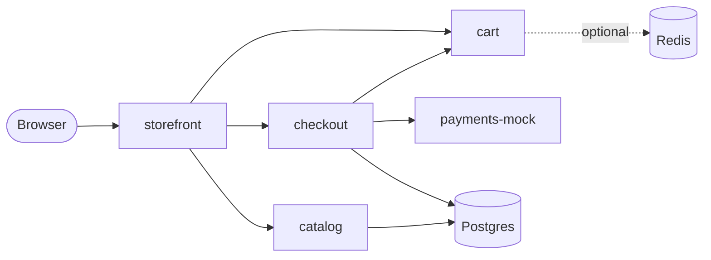

# mercadito-shop

A small online store built from five Go services: a server-rendered storefront, a product catalog, a cart, a checkout and a mock payment provider. Postgres 16 and Redis 7 are the backing services.

[](LICENSE)
[](go.mod)
[](Dockerfile)
[](Makefile)

## Architecture



| Service | Port | Purpose |
|---|---|---|
| `storefront` | 8080 | HTML pages: product list, search, product page with recommendations, cart, checkout |
| `catalog` | 8081 | Products, search, recommendations, image thumbnails |
| `cart` | 8082 | One cart per session |
| `checkout` | 8083 | Validates the cart, reserves stock, takes payment, records the order |
| `payments-mock` | 8084 | Fake payment provider |

Every service exposes `/healthz`, `/readyz` and `/metrics` (Prometheus), writes JSON logs to stdout, and adds an `X-Served-By` response header with the pod name (`POD_NAME`).

## Run locally

Requires Docker with Compose.

```sh
docker compose up --build
```

Then open <http://localhost:8080> (set `APP_PORT` to use another port). Browse, add products to the cart and place an order.

## Build the images

One Dockerfile builds every service; choose the service with a build argument:

```sh
docker build --build-arg SERVICE=storefront .
docker build --build-arg SERVICE=catalog .
docker build --build-arg SERVICE=cart .
docker build --build-arg SERVICE=checkout .
docker build --build-arg SERVICE=payments-mock .
```

The images contain a single static binary and run as a non-root user. `catalog migrate` creates the schema and seed data (about 500 products). Each binary also accepts `healthcheck`, which probes its own `/readyz` and exits 0 or 1.

## Kubernetes manifests

`deploy/base/` has plain YAML for every service. See [`deploy/base/README.md`](deploy/base/README.md) for its structure and the Secrets it expects.

## Configuration

All settings are environment variables.

<!-- env:start -->
| Variable | Services | Default | Description |
|---|---|---|---|
| `PORT` | storefront | `8080` | Listen port. |
| `CATALOG_URL` | storefront | `http://catalog:8081` | Base URL of the catalog service. |
| `CART_URL` | storefront, checkout | `http://cart:8082` | Base URL of the cart service. |
| `CHECKOUT_URL` | storefront | `http://checkout:8083` | Base URL of the checkout service. |
| `REDIS_URL` | storefront, catalog, checkout, payments-mock | _(unset)_ | Redis URL used to share runtime toggles between replicas (optional). |
| `ADMIN_TOKEN` | storefront, catalog, cart, checkout, payments-mock | _(unset)_ | Enables /admin routes when set; they return 404 otherwise. |
| `POD_NAME` | storefront, catalog, cart, checkout, payments-mock | `local` | Pod name, reported in logs and the X-Served-By header. |
| `SHUTDOWN_DRAIN_SECONDS` | storefront, catalog, cart, checkout, payments-mock | `0` | Seconds to keep serving after SIGTERM before shutting down. |
| `PORT` | catalog | `8081` | Listen port. |
| `DATABASE_URL` | catalog, checkout | _(unset)_ | Postgres connection URL. |
| `WARMUP_SECONDS` | catalog | `45` | Seconds spent building the search index at start-up; /readyz returns 503 until it finishes. |
| `THUMB_CACHE_MAX_MB` | catalog | `0` | Maximum size of the in-memory thumbnail cache in MB; 0 means no limit. |
| `SEED_PRODUCTS` | catalog | `500` | Number of products created by the migrate command. |
| `PORT` | cart | `8082` | Listen port. |
| `CART_STORE` | cart | `memory` | Where carts are kept: memory or redis. |
| `REDIS_URL` | cart | _(unset)_ | Redis URL. Used for carts when CART_STORE=redis, and for sharing runtime toggles. |
| `CART_TTL` | cart | `24h` | How long an idle cart is kept in Redis (Go duration). |
| `PORT` | checkout | `8083` | Listen port. |
| `DB_MAX_CONNS` | checkout | `2` | Maximum Postgres connections held by each replica. |
| `PAYMENTS_URL` | checkout | `http://payments-mock:8084` | Base URL of the payment provider. |
| `PAYMENT_TIMEOUT_MS` | checkout | `30000` | Time allowed for one payment attempt, in milliseconds. |
| `PAYMENT_RETRIES` | checkout | `0` | Extra payment attempts after a failure or timeout. |
| `PAYMENT_BACKOFF_MS` | checkout | `100` | Base delay between payment retries, in milliseconds; doubles each retry with full jitter. |
| `PORT` | payments-mock | `8084` | Listen port. |
| `PAYMENT_LATENCY_MS` | payments-mock | `50` | Base time a charge takes, in milliseconds. |
| `PAYMENT_JITTER_MS` | payments-mock | `0` | Random extra delay of up to this many milliseconds. |
| `PAYMENT_FAILURE_RATE` | payments-mock | `0` | Fraction of charges (0 to 1) that fail with 502. |
<!-- env:end -->

## Tests

Requires Go (see `go.mod`).

```sh
make test         # unit tests (race detector on)
make integration  # also runs tests that need Postgres: DATABASE_URL=postgres://... make integration
make ci           # vet, lint, tests, image build, size and user checks, vulnerability scan
```

## Layout

```
cmd/<service>/     entry points
internal/          service code and shared packages (config, httpx, admin)
web/               storefront templates and static files
deploy/base/       Kubernetes manifests
```
